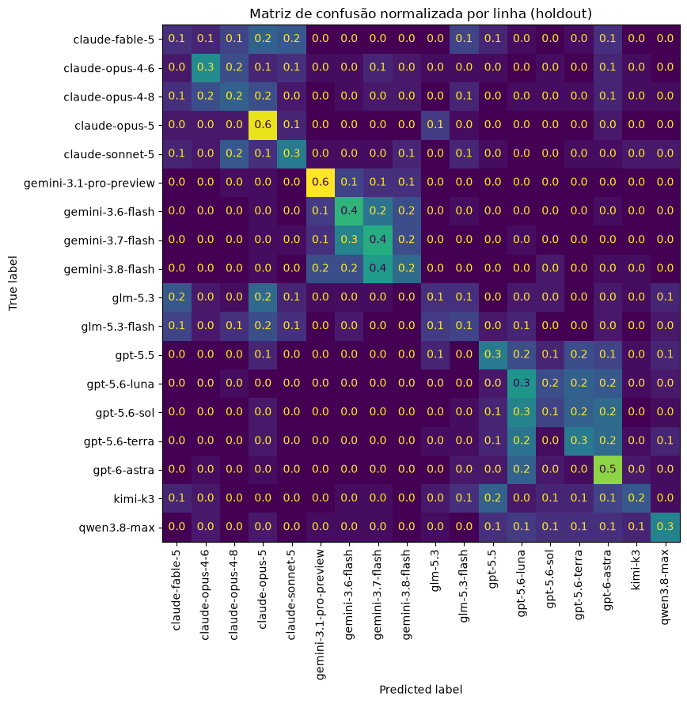

# Name That LLM

Minha participação na competição do Kaggle [Name That LLM](https://www.kaggle.com/competitions/name-that-llm): identificar qual de 18 LLMs escreveu cada texto. A métrica é a balanced accuracy.

## Resultados

| Experimento | Balanced accuracy (GroupKFold por prompt, 5 folds) |
|---|---|
| TF-IDF de palavras + regressão logística | 26,86% ± 0,89% |
| TF-IDF de caracteres + regressão logística | 29,63% ± 0,53% |
| Palavras + caracteres + regressão logística | 30,89% ± 1,33% |
| **GridSearch (128 configurações): palavras + caracteres `char` sem lowercase + regressão logística `C=10`** | **32,52% ± 1,86%** |

Holdout com prompts nunca vistos: 30,00%. O chute aleatório seria 5,6%. Histórico completo em [`reports/resultados.md`](reports/resultados.md).



## Principais achados

- **O modelo reconhece a família, mas confunde as versões.** 55% dos erros acontecem dentro da mesma família (Claude, Gemini, GPT); ao acaso seriam cerca de 18%. A matriz acima mostra os blocos.
- **Estilo pesa mais que vocabulário.** N-gramas de caracteres superam palavras, e manter maiúsculas (`lowercase=False`) melhora todas as combinações testadas.
- **Validar por prompt é obrigatório.** Cada prompt foi respondido pelos 18 modelos; separar os folds por `prompt_id` evita que o modelo seja avaliado em prompts que já viu.
- **Próximo passo:** os melhores notebooks públicos chegam a ~0,70 com LLMs ajustados por LoRA. Este repositório é o baseline clássico contra o qual um modelo de linguagem deve ser comparado.

## Estrutura

```
data/                  dados da competição (não versionados)
notebooks/
  01-sanjos-eda.ipynb              exploração dos dados
  02-sanjos-baselines-tfidf.ipynb  experimentos, GridSearch e análise de erros
  03-sanjos-submissao.ipynb        só o modelo vencedor e a submissão (enviado ao Kaggle)
  archive/                         versões antigas
reports/resultados.md  registro de todos os experimentos
reports/figures/       figuras usadas no README
submissions/           arquivos de submissão (não versionados)
```

As seções seguem as etapas do checklist de projeto de Machine Learning (Géron): o notebook 01 cobre as etapas 1–3 (problema, dados, exploração) e o 02, as etapas 4–7 (preparação, modelos, otimização com GridSearch, apresentação e submissão).

## Como reproduzir

```bash
python3 -m venv .venv && source .venv/bin/activate
pip install pandas numpy scikit-learn pyarrow matplotlib jupyter kaggle
kaggle competitions download -c name-that-llm -p data && unzip -o data/name-that-llm.zip -d data
jupyter notebook notebooks/
```

No Kaggle, os notebooks leem os dados de `/kaggle/input/competitions/name-that-llm` (ou `/kaggle/input/name-that-llm`); localmente, de `data/`. No Kaggle o GridSearch não roda: o notebook usa os melhores parâmetros encontrados localmente e termina em ~3 min.

## Como foi desenvolvido

A exploração e os experimentos iniciais são meus; a organização do repositório, o GridSearch final e a análise de erros foram feitos com apoio de um assistente de IA (Claude Code).
